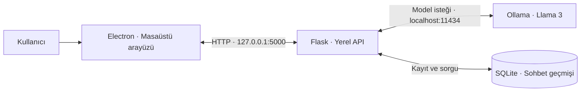

<div align="center">

# LocalChat

### Kendi bilgisayarında çalışan kişisel yapay zekâ sohbet alanın.

**Yerel model. Masaüstü deneyimi. Kalıcı sohbet geçmişi.**

[Özellikler](#özellikler) · [Kurulum](#kurulum) · [Mimari](#mimari) · [Proje yapısı](#proje-yapısı)

</div>

---

LocalChat, büyük dil modellerini masaüstüne taşıyan bir sohbet uygulamasıdır. **Electron** arayüzünü, **Flask** tabanlı bir Python servisini ve **Ollama** üzerinde çalışan **Llama 3** modelini bir araya getirir. Sohbet kayıtları **SQLite** ile bilgisayarda tutulur.

Mesajını yaz, yerel modelin yanıtını al ve konuşmana daha sonra kaldığın yerden devam et. Sohbetleri başlıklar, favoriler ve arşivlerle düzenleyen arayüz; modelle etkileşimi tek bir masaüstü çalışma alanında toplar.

## Neden LocalChat?

- **Bilgisayarında model çalıştır:** Yanıt üretimi yerel Ollama servisi üzerinden gerçekleşir.
- **Sohbetlerini sakla:** Konuşmalar ve mesajlar SQLite veritabanına kaydedilir.
- **Masaüstünden eriş:** Electron penceresi üzerinden sohbet et, geçmişini görüntüle ve konuşmalarını düzenle.
- **Akışı incele ve geliştir:** Arayüz, API ve veri katmanı ayrı dosyalarda bulunur; projenin her aşaması kaynak koddan takip edilebilir.

Model ve bağımlılıklar indirildikten sonra temel sohbet akışı internet bağlantısı gerektirmez. Sohbet akışında ücretli bir bulut API anahtarı kullanılmaz. Yanıt hızı ve modelin bellek ihtiyacı bilgisayarın donanımına bağlıdır.

## Özellikler

| Alan | Uygulamada sunulanlar |
| --- | --- |
| **Yerel sohbet** | Ollama üzerinden Llama 3 ile metin tabanlı konuşma |
| **Konuşma bağlamı** | Son 10 geçmiş mesajın yeni model isteğine eklenmesi |
| **Kalıcı kayıt** | Konuşmaların, mesajların ve sohbet ayarlarının SQLite ile saklanması |
| **Sohbet yönetimi** | Yeni konuşma, başlık düzenleme, favori sohbetler ve arşiv görünümleri |
| **Arama** | Yüklenmiş sohbetlerin başlık ve mesaj metinlerinde arama |
| **Görünüm** | Açılır yan panel ve açık/koyu tema geçişi |
| **Ayar paneli** | Sistem davranışı, temperature, top-p, top-k ve tekrar cezası alanları |
| **Klavye kullanımı** | Enter ile gönderme, Shift + Enter ile yeni satır |

## Teknoloji yığını

| Katman | Teknoloji | Görevi |
| --- | --- | --- |
| Masaüstü kabuğu | Electron | Uygulama penceresi ve Python servisini başlatma |
| Arayüz | HTML, CSS, JavaScript | Sohbet ekranı, yan panel ve kullanıcı etkileşimleri |
| Yerel API | Python, Flask, Flask-CORS | Sohbet ve kayıt işlemleri için HTTP uç noktaları |
| Model servisi | Ollama | Yerel büyük dil modelini çalıştırma |
| Dil modeli | Llama 3 | Metin yanıtlarını üretme |
| Veri katmanı | SQLite | Sohbet geçmişini ve ayarları saklama |
| Paketleme | electron-builder | Masaüstü dağıtım çıktısı hazırlama |

## Mimari



1. Arayüz mesajı ve aktif sohbet kimliğini Flask servisine gönderir.
2. Servis geçmiş mesajları ve sistem davranışı metnini bir prompt içinde birleştirir.
3. Ollama, `llama3` modeliyle yanıt üretir.
4. Kullanıcı mesajı ve model yanıtı veritabanına kaydedilir.
5. Yanıt masaüstü arayüzünde gösterilir.

## Kurulum

### Gereksinimler

- **Windows**: Projenin mevcut masaüstü paketleme hedefi.
- **Python 3.10 veya üzeri**: Sunucu kodu Python 3.10 tip sözdizimini kullanır.
- **Node.js ve npm**: Electron bağımlılıklarını kurmak ve uygulamayı başlatmak için.
- **Ollama** ve indirilmiş **`llama3`** modeli.
- Modelin çalışmasına yetecek boş bellek ve disk alanı.

Yerel çalışma kontrolü Python **3.10.0**, Node.js **22.17.0** ve Ollama üzerindeki `llama3:latest` modeliyle yapıldı.

### 1. Depoyu klonla

```powershell
git clone https://github.com/zeynebyy/LocalChat.git
cd LocalChat
```

### 2. Python ortamını hazırla

```powershell
python -m venv .venv
.\.venv\Scripts\Activate.ps1
python -m pip install -r requirements.txt
```

`requirements.txt`, Flask API bağımlılıklarıyla birlikte projede bulunan Python arayüzü ve model denemeleri için ek paketleri de içerir. Ana Electron sohbet akışında model çıkarımını Ollama yürütür.

PowerShell ortam etkinleştirmesi kapalıysa, Windows Komut İstemi üzerinden devam edebilirsin:

```bat
.venv\Scripts\activate.bat
```

### 3. Electron bağımlılıklarını kur

```powershell
npm ci
```

### 4. Ollama modelini hazırla

[Ollama](https://ollama.com/) uygulamasını kurduktan sonra:

```powershell
ollama pull llama3
ollama list
```

Ollama servisinin çalışıyor olması gerekir. Masaüstü uygulaması servisi zaten başlatıyorsa ayrıca komut çalıştırmana gerek yoktur. Servisi elle çalıştırmak için ayrı bir terminalde:

```powershell
ollama serve
```

### 5. Masaüstü uygulamasını aç

Python sanal ortamının etkin olduğu terminalde, proje kökünden:

```powershell
npm start
```

Electron penceresi açılır ve başlangıç kodu Flask sunucusunu çalıştırır. Terminalde Flask'ın `127.0.0.1:5000` adresinde hazır olduğunu gördükten sonra sohbet etmeye başlayabilirsin.

## Kullanım

1. **Yeni** düğmesiyle bir konuşma başlat.
2. Mesajını yazıp **Gönder** düğmesine veya **Enter** tuşuna bas.
3. Yanıt geldikten sonra konuşmaya devam et.
4. Yan panelden kayıtlı sohbetlerini aç, başlıklarını düzenle ve favori ya da arşiv görünümlerine geç.
5. **Ayarlar** panelinden sistem davranışı metnini ve üretim parametrelerine ait alanları düzenle.

Veritabanı ilk Python çalıştırmasında proje kökünde `chat_history.db` adıyla oluşturulur. Bu dosya kişisel sohbet geçmişini içerdiği için Git takibine alınmaz.

## Proje yapısı

```text
LocalChat/
├── backend/
│   └── app.py             # Flask API ve Ollama bağlantısı
├── database/
│   └── db.py              # SQLite şeması ve veri işlemleri
├── frontend/
│   ├── index.html         # Electron sohbet ekranı
│   ├── style.css          # Görünüm ve temalar
│   ├── script.js          # Arayüz mantığı ve API istekleri
│   └── gui.py             # Alternatif Tkinter arayüz denemesi
├── test/
│   └── test_api.py        # API testleri için ayrılmış dosya
├── main.js               # Electron başlangıç noktası
├── package.json          # Masaüstü komutları ve paketleme ayarları
├── package-lock.json     # JavaScript bağımlılık kilidi
├── requirements.txt      # Python bağımlılıkları
├── aes.py                # Bağımsız AES denemesi
├── rsa.py                # Bağımsız RSA denemesi
├── kontrol.py            # Yerel veritabanı kontrol betiği
└── README.md
```

`aes.py` ve `rsa.py` bağımsız şifreleme örnekleridir; ana sohbet depolama akışına bağlı değildir. Bu örnekleri ayrıca çalıştırmak için `python -m pip install pycryptodome` komutu kullanılabilir.

## Yerel API

Varsayılan Flask adresi: `http://127.0.0.1:5000`

| Yöntem | Uç nokta | Amaç |
| --- | --- | --- |
| `POST` | `/chat` | Mesaj gönderme ve model yanıtı alma |
| `GET` | `/conversations` | Aktif sohbetleri listeleme |
| `GET` | `/conversation/<id>` | Bir sohbetin mesajlarını getirme |
| `POST` | `/rename/<id>` | Sohbet başlığını değiştirme |
| `POST` | `/conversation/<id>/favorite` | Sohbet favori durumunu güncelleme |
| `GET` | `/conversations/favorites` | Favori sohbetleri listeleme |
| `POST` | `/conversation/<id>/archive` | Sohbetin arşiv durumunu güncelleme |
| `GET` | `/conversations/archived` | Arşivlenmiş sohbetleri listeleme |
| `GET`, `POST` | `/settings/<id>` | Sohbet ayarlarını okuma ve kaydetme |

Örnek ilk mesaj isteği:

```json
{
  "prompt": "Yerel yapay zekâ modellerini kısaca anlat."
}
```

Yanıt `response` ve `conversation_id` alanlarını içerir. Konuşmaya devam eden isteklerde aynı `conversation_id` gönderilir.

## Geliştirme ve paketleme

Sunucuyu arayüzden bağımsız çalıştırmak için:

```powershell
python backend/app.py
```

Masaüstü arayüzünü ayrıca çalıştırmak istediğinde tek bir Flask servisinin `5000` portunu kullanmasını sağla; `npm start` kendi sunucu başlatma çağrısını da yapar.

Windows dağıtım çıktısı hazırlamak için:

```powershell
npm run build
```

Paketleme ayarları `package.json` içindeki `build` bölümündedir; çıktı dizini `dist/` olarak kullanılır. Python ortamı ve yerel Ollama kurulumu çalışma mimarisinin parçalarıdır.

## Katkıda bulunma

Yeni bir özellik, arayüz iyileştirmesi veya dokümantasyon katkısı için depoyu fork edebilir, değişikliğini ayrı bir dalda hazırlayıp pull request açabilirsin. Önerilerini [Issues](https://github.com/zeynebyy/LocalChat/issues) üzerinden paylaşabilirsin.

---

<div align="center">

**LocalChat — Yapay zekâyla sohbet, kendi çalışma alanında.**

[GitHub · zeynebyy/LocalChat](https://github.com/zeynebyy/LocalChat)

</div>
